---
prev:
  text: Advanced Examples
  link: /examples/advanced
---

# Concurrency Patterns

Common concurrency patterns solved with gofuncy.

## Fan-Out / Fan-In

Distribute work across multiple goroutines and collect all results.

::: code-group

<div class="vp-block active" data-title="Diagram"></div>

```go [Code]
package main

import (
	"context"
	"fmt"

	"github.com/foomo/gofuncy"
)

type Order struct {
	ID    int
	Total float64
}

func main() {
	ctx := context.Background()

	orderIDs := []int{101, 102, 103, 104, 105}

	// Fan out: fetch all orders concurrently (max 3 at a time)
	// Fan in: collect results in order
	orders, err := gofuncy.Map(ctx, orderIDs, func(ctx context.Context, id int) (Order, error) {
		// Simulate fetching from a database or API
		return Order{ID: id, Total: float64(id) * 9.99}, nil
	},
		gofuncy.WithLimit(3),
	)
	if err != nil {
		fmt.Println("errors:", err)
		return
	}

	for _, o := range orders {
		fmt.Printf("Order %d: $%.2f\n", o.ID, o.Total)
	}
}
```

:::

## Pipeline

Chain multiple transformation stages, each running concurrently.

::: code-group

<div class="vp-block active" data-title="Diagram"></div>

```go [Code]
package main

import (
	"context"
	"fmt"
	"strings"

	"github.com/foomo/gofuncy"
)

func main() {
	ctx := context.Background()

	raw := []string{"  hello  ", "  WORLD  ", "  GoFuncy  "}

	// Stage 1: trim whitespace
	trimmed, err := gofuncy.Map(ctx, raw, func(ctx context.Context, s string) (string, error) {
		return strings.TrimSpace(s), nil
	})
	if err != nil {
		fmt.Println("trim error:", err)
		return
	}

	// Stage 2: lowercase
	lowered, err := gofuncy.Map(ctx, trimmed, func(ctx context.Context, s string) (string, error) {
		return strings.ToLower(s), nil
	})
	if err != nil {
		fmt.Println("lowercase error:", err)
		return
	}

	fmt.Println(lowered) // [hello world gofuncy]
}
```

:::

## Timeout with Fallback

Attempt a primary operation with a timeout, then fall back to a cached value.

::: code-group

<div class="vp-block active" data-title="Diagram"></div>

```go [Code]
package main

import (
	"context"
	"errors"
	"fmt"
	"time"

	"github.com/foomo/gofuncy"
)

func main() {
	ctx := context.Background()

	var result string

	g := gofuncy.NewGroup(ctx,
		gofuncy.WithFailFast(),
	)

	g.Add(func(ctx context.Context) error {
		// Simulate a slow API call
		time.Sleep(2 * time.Second)
		if ctx.Err() != nil {
			return ctx.Err()
		}
		result = "fresh data from API"
		return nil
	},
		gofuncy.WithTimeout(500*time.Millisecond),
	)

	if err := g.Wait(); err != nil {
		// Timeout hit -- use fallback
		if errors.Is(err, context.DeadlineExceeded) {
			result = "cached data (fallback)"
		} else {
			fmt.Println("unexpected error:", err)
			return
		}
	}

	fmt.Println(result) // cached data (fallback)
}
```

:::

## Graceful Shutdown

Use context cancellation to signal all goroutines to stop.

::: code-group

<div class="vp-block active" data-title="Diagram"></div>

```go [Code]
package main

import (
	"context"
	"fmt"
	"os/signal"
	"syscall"
	"time"

	"github.com/foomo/gofuncy"
)

func main() {
	// Cancel on SIGINT or SIGTERM
	ctx, stop := signal.NotifyContext(context.Background(), syscall.SIGINT, syscall.SIGTERM)
	defer stop()

	g := gofuncy.NewGroup(ctx)

	for i := range 3 {
		g.Add(func(ctx context.Context) error {
			for {
				select {
				case <-ctx.Done():
					fmt.Printf("worker %d shutting down\n", i)
					return nil
				case <-time.After(500 * time.Millisecond):
					fmt.Printf("worker %d: tick\n", i)
				}
			}
		})
	}

	if err := g.Wait(); err != nil {
		fmt.Println("errors:", err)
	}

	fmt.Println("all workers stopped")
}
```

:::

## Batch Processing

Process a large dataset in batches with controlled concurrency.

::: code-group

<div class="vp-block active" data-title="Diagram"></div>

```go [Code]
package main

import (
	"context"
	"fmt"

	"github.com/foomo/gofuncy"
)

func main() {
	ctx := context.Background()

	// Simulate 100 items to process
	items := make([]int, 100)
	for i := range items {
		items[i] = i
	}

	// Process all items, 10 at a time
	err := gofuncy.All(ctx, items, func(ctx context.Context, item int) error {
		// Simulate processing
		if item%25 == 0 {
			fmt.Printf("processing item %d\n", item)
		}
		return nil
	},
		gofuncy.WithLimit(10),
	)
	if err != nil {
		fmt.Println("errors:", err)
	}

	fmt.Println("all items processed")
}
```

:::

## Parallel Aggregation

Run multiple data sources in parallel and aggregate results.

::: code-group

<div class="vp-block active" data-title="Diagram"></div>

```go [Code]
package main

import (
	"context"
	"fmt"
	"sync/atomic"

	"github.com/foomo/gofuncy"
)

func main() {
	ctx := context.Background()

	var totalUsers atomic.Int64
	var totalOrders atomic.Int64
	var totalRevenue atomic.Int64

	g := gofuncy.NewGroup(ctx)

	g.Add(func(ctx context.Context) error {
		// Fetch from users service
		totalUsers.Store(1500)
		return nil
	})

	g.Add(func(ctx context.Context) error {
		// Fetch from orders service
		totalOrders.Store(3200)
		return nil
	})

	g.Add(func(ctx context.Context) error {
		// Fetch from billing service
		totalRevenue.Store(450000)
		return nil
	})

	if err := g.Wait(); err != nil {
		fmt.Println("errors:", err)
		return
	}

	fmt.Printf("Users: %d, Orders: %d, Revenue: $%d\n",
		totalUsers.Load(), totalOrders.Load(), totalRevenue.Load())
	// Output: Users: 1500, Orders: 3200, Revenue: $450000
}
```

:::
