---
prev:
  text: Getting Started
  link: /guide/getting-started
next:
  text: Go API
  link: /api/go
---

# Core Concepts

## The Options Pattern

gofuncy uses functional options to configure behavior. There are three option categories:

| Type | Applies to | Example |
|------|-----------|---------|
| `baseOpt` | `Do`, `Wait`, `WaitWithStop`, `WaitWithReady`, `Go`, `Start`, `StartWithReady`, `StartWithStop`, `GoWithCancel`, `NewGroup`, `Group.Add` | `WithRetry`, `WithTimeout`, `WithCircuitBreaker`, `WithFallback`, `WithMiddleware`, `WithLogger`, `WithDetachedTrace`, `WithChildTrace` |
| `goOnlyOpt` | `Do`, `Wait`, `WaitWithStop`, `WaitWithReady`, `Go`, `Start`, `StartWithReady`, `StartWithStop`, `GoWithCancel`, `Group.Add` | `WithErrorHandler`, `WithCallerSkip` |
| `groupOnlyOpt` | `NewGroup` | `WithLimit`, `WithFailFast` |

Options are implemented as interfaces (`GoOption` and `GroupOption`), so the compiler prevents you from passing a group-only option to `Go()` or a go-only option to `NewGroup()`.

Use `WithName` to set a custom label for telemetry and context injection. When omitted, each function uses a low-cardinality default (e.g. `"gofuncy.go"`, `"gofuncy.group"`):

```go
// Default name: "gofuncy.go"
gofuncy.Go(ctx, fn, gofuncy.WithTimeout(5*time.Second))

// Custom name for better tracing
gofuncy.Go(ctx, fn, gofuncy.WithName("worker"), gofuncy.WithTimeout(5*time.Second))

// Group-only options work with NewGroup
g := gofuncy.NewGroup(ctx, gofuncy.WithLimit(10), gofuncy.WithFailFast())
```

When you pass options to `Group.Add`, they are **merged** on top of the group's options. Booleans are OR'd, slices are appended, and non-zero values override.

See the full [Options reference](/api/options) for every available option.

## Error Handling

### Panic Recovery

Every goroutine spawned by gofuncy automatically recovers from panics. A recovered panic is wrapped in a `*PanicError` that preserves the original value and the full stack trace:


```go
type PanicError struct {
    Value any    // the recovered panic value
    Stack []byte // runtime/debug.Stack() output
}
```

You can check for panics using `errors.As`:

```go
var panicErr *gofuncy.PanicError
if errors.As(err, &panicErr) {
    fmt.Printf("panic: %v\nstack:\n%s\n", panicErr.Value, panicErr.Stack)
}
```

### Error Collection

- `Go` -- errors are passed to an `ErrorHandler` callback. The default handler logs via `slog.ErrorContext`. Override with `WithErrorHandler`.
- `Group.Wait` -- returns all errors from added functions via `errors.Join`.
- `All` and `Map` -- return all errors via `errors.Join`.


### Fail-Fast

Pass `WithFailFast()` to `NewGroup` to cancel all remaining functions when the first error occurs. The group's context is cancelled, so functions that check `ctx.Err()` will exit early.


## Context and Naming

gofuncy injects routine metadata into the context automatically:

::: code-group

<div class="vp-block active" data-title="Diagram"></div>

```go [Code]
// Extract the routine name (defaults to "noname")
name := gofuncy.NameFromContext(ctx)

// Extract the parent routine name (empty if none)
parent := gofuncy.ParentFromContext(ctx)
```

:::

You can also use the `Context` helper:

```go
c := gofuncy.Ctx(ctx)
c.Name()   // routine name
c.Parent() // parent name
c.Root()   // returns context with name set to "root"
```

Names are used in OpenTelemetry spans and metrics attributes, making it easy to trace goroutine hierarchies in your observability stack.

## Concurrency Control

gofuncy offers two levels of concurrency limiting:

### Per-Group: WithLimit

Limits the number of concurrently executing functions within a single group. Uses an internal buffered channel as a semaphore.

::: code-group

<div class="vp-block active" data-title="Diagram"></div>

```go [Code]
// At most 2 functions run at the same time
g := gofuncy.NewGroup(ctx, gofuncy.WithLimit(2))
```

:::

### Cross-Callsite: WithLimiter

Shares a `*semaphore.Weighted` across multiple `Go` or `Group.Add` calls, even across different groups. The semaphore is acquired before the goroutine starts and released when it completes.

::: code-group

<div class="vp-block active" data-title="Diagram"></div>

```go [Code]
import "golang.org/x/sync/semaphore"

// Global limiter: at most 20 concurrent goroutines across all call sites
limiter := semaphore.NewWeighted(20)

gofuncy.Go(ctx, fn1, gofuncy.WithLimiter(limiter))
gofuncy.Go(ctx, fn2, gofuncy.WithLimiter(limiter))
```

:::

::: warning
`WithLimiter` acquires the semaphore **before** spawning the goroutine. If the context is cancelled while waiting, the error is handled immediately and the goroutine is not started.
:::

## Resilience

gofuncy provides built-in resilience primitives configured via options. The framework applies them in the correct order automatically:

```
fn → timeout → retry → circuitBreaker → fallback
```

### Retry

Retries transient errors with configurable backoff:

::: code-group

<div class="vp-block active" data-title="Diagram"></div>

```go [Code]
gofuncy.Go(ctx, fetchData,
    gofuncy.WithRetry(3),
    gofuncy.WithTimeout(5*time.Second), // per-attempt timeout
)
```

:::

By default, retry uses exponential backoff with jitter (100ms base, 2x multiplier, 30s cap) and skips non-retryable errors (`context.Canceled`, `context.DeadlineExceeded`, `*PanicError`).

See the [Options reference](/api/options) for all retry options and backoff strategies.

### Circuit Breaker

Stops calling a broken dependency after repeated failures:

::: code-group

<div class="vp-block active" data-title="Diagram"></div>

```go [Code]
var apiBreaker = gofuncy.NewCircuitBreaker(
    gofuncy.CircuitBreakerThreshold(5),
    gofuncy.CircuitBreakerCooldown(30*time.Second),
)

gofuncy.Go(ctx, callAPI,
    gofuncy.WithCircuitBreaker(apiBreaker),
)
```

:::

The circuit breaker is stateful — share a single instance across all calls to the same dependency.

### Fallback

Graceful degradation when a function fails:

::: code-group

<div class="vp-block active" data-title="Diagram"></div>

```go [Code]
g.Add(fetchFromAPI,
    gofuncy.WithRetry(3),
    gofuncy.WithFallback(func(ctx context.Context, err error) error {
        return loadFromCache(ctx)
    }),
)
```

:::

See the [Options reference](/api/options) for fallback options.

### Combining Resilience Options

All resilience options compose naturally. The framework guarantees the correct ordering:

::: code-group

<div class="vp-block active" data-title="Diagram"></div>

```go [Code]
g.Add(callAPI,
    gofuncy.WithTimeout(2*time.Second),          // each attempt: 2s
    gofuncy.WithRetry(3),                         // up to 3 attempts
    gofuncy.WithCircuitBreaker(apiBreaker),       // fail fast on broken dep
    gofuncy.WithFallback(func(ctx context.Context, err error) error {
        return loadFromCache(ctx)                 // last resort
    }),
)
```

:::

## Custom Middleware

For custom cross-cutting behavior, use the `Middleware` type with `WithMiddleware`:


```go
type Middleware func(Func) Func
```

User middlewares are applied **after** the built-in resilience chain and **before** telemetry:

```go
logging := func(next gofuncy.Func) gofuncy.Func {
    return func(ctx context.Context) error {
        fmt.Println("start")
        err := next(ctx)
        fmt.Println("done")
        return err
    }
}

gofuncy.Go(ctx, fn, gofuncy.WithMiddleware(logging))
```

The built-in resilience primitives (`Retry`, `Fallback`) are also available as middleware constructors for advanced use cases that require custom ordering via `WithMiddleware`.

## Telemetry

OpenTelemetry tracing and metrics are enabled by default. Every `Go` and `Group.Add` call creates a span and emits metrics.

### Metrics (enabled by default)

| Metric | Type | Description |
|--------|------|-------------|
| `gofuncy.goroutines.started` | Counter | Total goroutines started |
| `gofuncy.goroutines.errors` | Counter | Total goroutine errors |
| `gofuncy.goroutines.active` | UpDownCounter | Currently active goroutines |
| `gofuncy.goroutines.retries` | Counter | Total retry attempts |
| `gofuncy.goroutines.circuitbreaker.rejected` | Counter | Total circuit breaker rejections |

### Optional Metrics

| Metric | Type | Enabled via |
|--------|------|-------------|
| `gofuncy.goroutines.duration.seconds` | Histogram | `WithDurationHistogram()` |
| `gofuncy.groups.duration.seconds` | Histogram | `WithDurationHistogram()` on group |

### Disabling Telemetry

```go
gofuncy.Go(ctx, fn,
    gofuncy.WithoutTracing(),
    gofuncy.WithoutStartedCounter(),
    gofuncy.WithoutErrorCounter(),
    gofuncy.WithoutActiveUpDownCounter(),
)
```

### Custom Providers

```go
gofuncy.Go(ctx, fn,
    gofuncy.WithMeterProvider(customMeterProvider),
    gofuncy.WithTracerProvider(customTracerProvider),
)
```

All metrics use the scope name `github.com/foomo/gofuncy` and the OpenTelemetry schema URL `https://opentelemetry.io/schemas/v1.40.0`.
