---
prev:
  text: Introduction
  link: /guide/introduction
next:
  text: Core Concepts
  link: /guide/concepts
---

# Getting Started

## Requirements

- Go 1.26 or later

## Installation

```sh
go get github.com/foomo/gofuncy
```

## Fire-and-Forget with Go

The simplest use case is spawning a goroutine that handles its own errors:

::: code-group

<div class="vp-block active" data-title="Diagram"></div>

```go [Code]
package main

import (
	"context"
	"fmt"
	"time"

	"github.com/foomo/gofuncy"
)

func main() {
	ctx := context.Background()

	// Spawn a fire-and-forget goroutine.
	// Errors are logged via slog by default.
	gofuncy.Go(ctx, func(ctx context.Context) error {
		fmt.Println("working in the background")
		return nil
	})

	time.Sleep(100 * time.Millisecond) // wait for goroutine to finish
}
```

:::

`Go` automatically:
- Recovers panics (converts them to `*PanicError`)
- Logs errors via `slog` (override with `WithErrorHandler`)
- Creates an OpenTelemetry span
- Emits started, error, and active goroutine metrics

## Running Functions in Parallel with Group

When you need to wait for multiple goroutines and collect their errors:

::: code-group

<div class="vp-block active" data-title="Diagram"></div>

```go [Code]
package main

import (
	"context"
	"fmt"

	"github.com/foomo/gofuncy"
)

func main() {
	ctx := context.Background()

	g := gofuncy.NewGroup(ctx)

	g.Add(func(ctx context.Context) error {
		fmt.Println("fetching users")
		return nil
	})

	g.Add(func(ctx context.Context) error {
		fmt.Println("fetching orders")
		return nil
	})

	// Wait blocks until all functions complete.
	// Returns all errors joined via errors.Join.
	if err := g.Wait(); err != nil {
		fmt.Println("errors:", err)
	}
}
```

:::

## Transforming a Slice with Map

Use `Map` to transform items concurrently while preserving input order:

::: code-group

<div class="vp-block active" data-title="Diagram"></div>

```go [Code]
package main

import (
	"context"
	"fmt"
	"strings"

	"github.com/foomo/gofuncy"
)

func main() {
	ctx := context.Background()

	words := []string{"hello", "world", "gofuncy"}

	upper, err := gofuncy.Map(ctx, words, func(ctx context.Context, word string) (string, error) {
		return strings.ToUpper(word), nil
	})
	if err != nil {
		fmt.Println("error:", err)
		return
	}

	fmt.Println(upper) // [HELLO WORLD GOFUNCY]
}
```

:::

## Next Steps

- Learn about the [core concepts](/guide/concepts) behind gofuncy's design
- Browse the [API reference](/api/go) for detailed function documentation
- See [examples](/examples/basic) for common patterns
